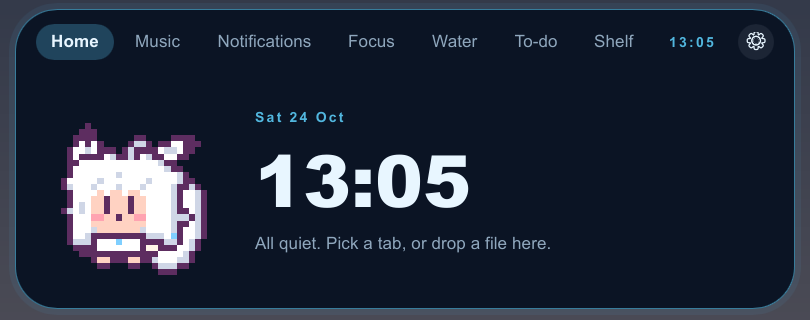
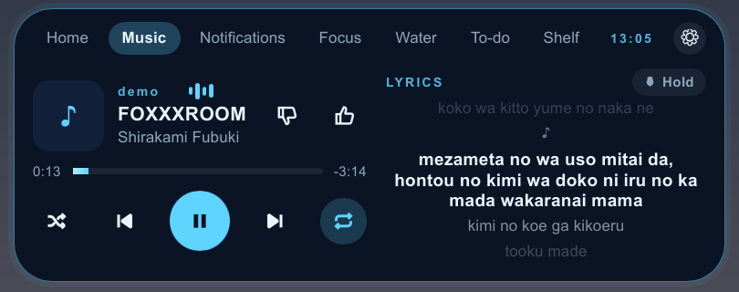
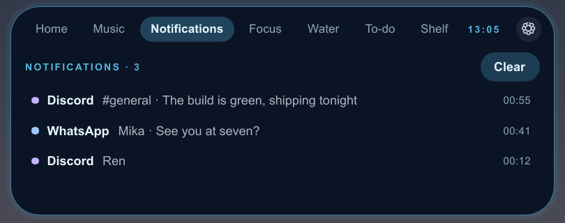
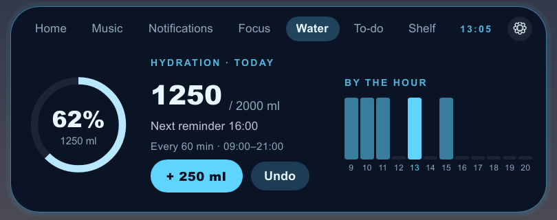
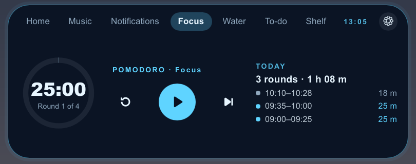
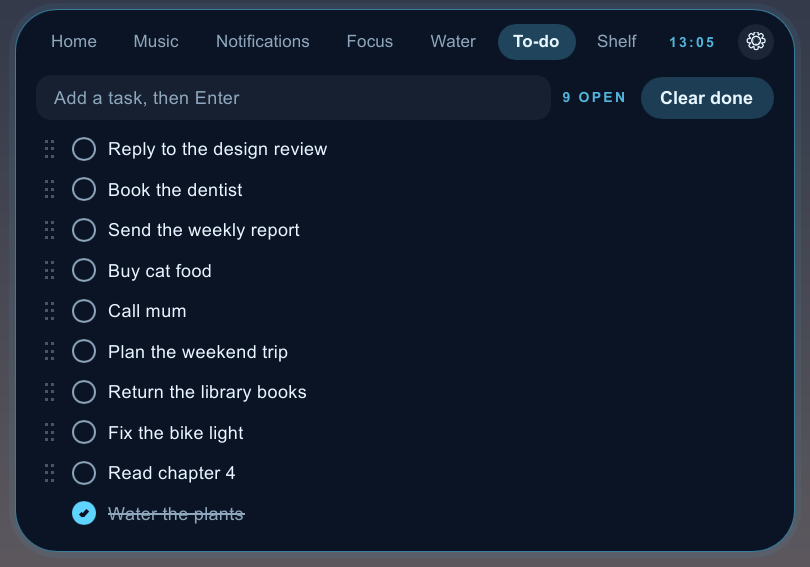
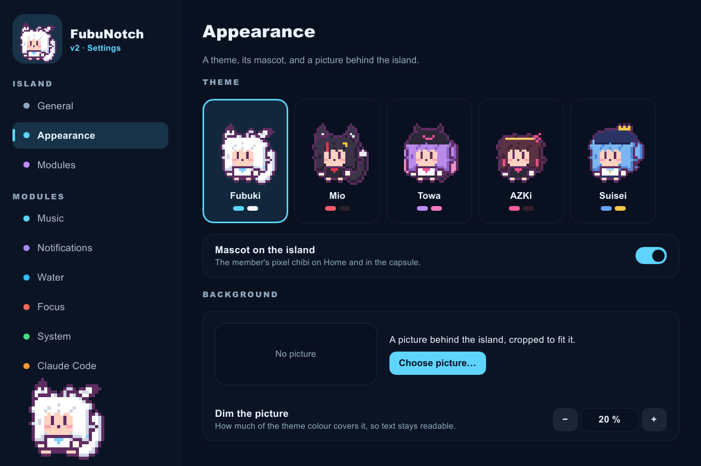

# FubuNotch v2

A small "dynamic island" for Windows: a capsule at the top of the screen that shows what is going on — the song playing (with synced lyrics), your notifications, volume and device changes, a Pomodoro, water reminders, a to-do list, a shelf for files, and Claude Code's permission questions — and a pixel mascot who lives in it.

Native Rust, no browser engine: about 40 MB of RAM and next to no CPU while it sits hidden.



> **Early test build.** It works day to day on the author's PC, but it is young: expect rough edges, and please report what breaks.

## Download and install

1. Go to **[Releases](../../releases)** and download `FubuNotch-v2-windows-x64.zip`.
2. Unzip it anywhere (for example `Documents\FubuNotch v2`). Keep the two `.exe` files together.
3. Run `fubunotch-v2.exe`.
   - Windows SmartScreen may say "Windows protected your PC" because the app is not signed: click **More info → Run anyway**.
   - The first time, Windows asks whether the app may read your notifications: allow it if you want them on the island.
4. A thin bar appears at the top centre of the screen. Point at it to open the island. Right-click the tray icon (bottom right) for **Settings** and **Quit**.

To start it with Windows: Settings → General → Start with Windows.
To remove it: Quit from the tray, delete the folder, and delete `%APPDATA%\FubuNotch v2` (its settings).

Windows 10/11, 64-bit.

## What it does

| | |
|---|---|
|  | **Music** — whatever is playing in Spotify, YouTube Music in a browser, or any player that shows in Windows' media controls. Play/pause, next, previous; shuffle and repeat when the player allows it; for YouTube Music in Chrome or Edge, add the small [extension](extension/ytm) (browsers don't pass shuffle and repeat to Windows). Like/dislike (kept on your PC). Synced lyrics from LRCLIB, or YouTube Music when LRCLIB has none, with Japanese in romaji. **Hold** keeps the island open while you read along. |
|  | **Notifications** — Windows notifications, mirrored on the island; a switch per app in Settings, as in Windows. A click opens the app. |
|  | **Water** — a glass at a time toward a daily goal, reminders after a while without one, only inside your active hours. |
|  | **Focus** — Pomodoro rounds and breaks, with a log of how long each round really was. |
|  | **To-do** — tick to strike through (done ones sink to the bottom), drag the dots to reorder; the island grows for a long list. |

Also: **System** notices (volume, Caps Lock, keyboard layout, charger, Wi-Fi, headphones and Bluetooth headsets with their battery), a **Shelf** (drop files on the island to keep them handy), and **Claude Code**: Allow / Deny its permission requests from the island (Settings → Claude Code; it shows exactly what it will change in Claude Code's settings and backs the file up first).

### Looks

Five themes, each with its own colours and pixel mascot: **Fubuki**, **Mio**, **Towa**, **AZKi** and **Suisei**. The mascot breathes, blinks, wags, walks about, naps when left alone and hops when you click her. You can also put your own picture behind the island (Settings → Appearance).



### Privacy

Nothing leaves your PC except what you turn on: lyrics look-ups send the song's title, artist, album and length to LRCLIB (and YouTube Music if that switch is on). No telemetry, no account. Settings and data stay in `%APPDATA%\FubuNotch v2`.

## For developers

```
cargo run -p fubunotch-v2          # the island
cargo test --workspace             # the checks
.\scripts\try.ps1                  # three sample activities through the local webhook (-Clear ends them)
python scripts\sprites.py          # redraw the mascots from pixel-art\holo-tiny\build.py
```

Needs Rust (stable) and the MSVC Build Tools ("Desktop development with C++"). UI in [Slint](https://slint.dev) with its software renderer. `crates/island-core` holds the activity contract and the arbiter (no UI, no I/O), `crates/island-webhook` a local webhook on `127.0.0.1:47821` that scripts and other apps can post activities to (bearer token in `%APPDATA%\FubuNotch v2\token`), `crates/island-lyrics` the lyrics. `CLAUDE.md` has the house rules.

Checks without a screen: `FUBUNOTCH_V2_SNAPSHOT=out.png` draws the island into a PNG and exits (see `CLAUDE.md` for the switches that go with it).

## License and credits

The code is MIT, see [LICENSE](LICENSE).

This is an unofficial, non-commercial fan project. It is not affiliated with or endorsed by COVER Corporation or hololive production. Shirakami Fubuki, Ookami Mio, Tokoyami Towa, AZKi and Hoshimachi Suisei are hololive production talents; the pixel mascots are fan art drawn for this project, and the MIT license does not grant any rights to the characters. If you are a rights holder and want something changed, please open an issue.
