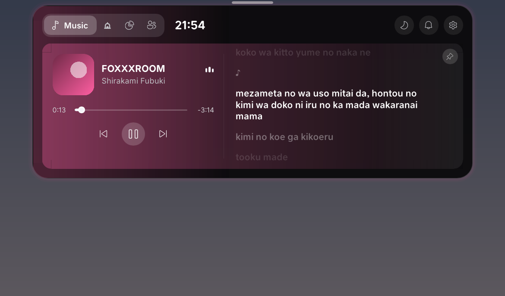
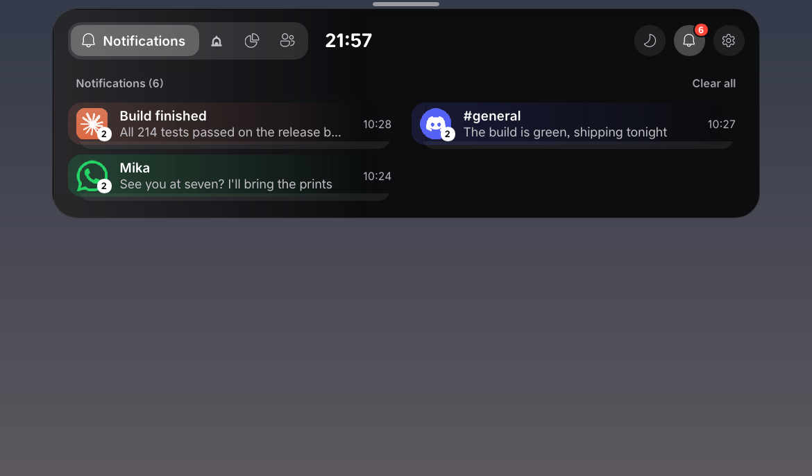
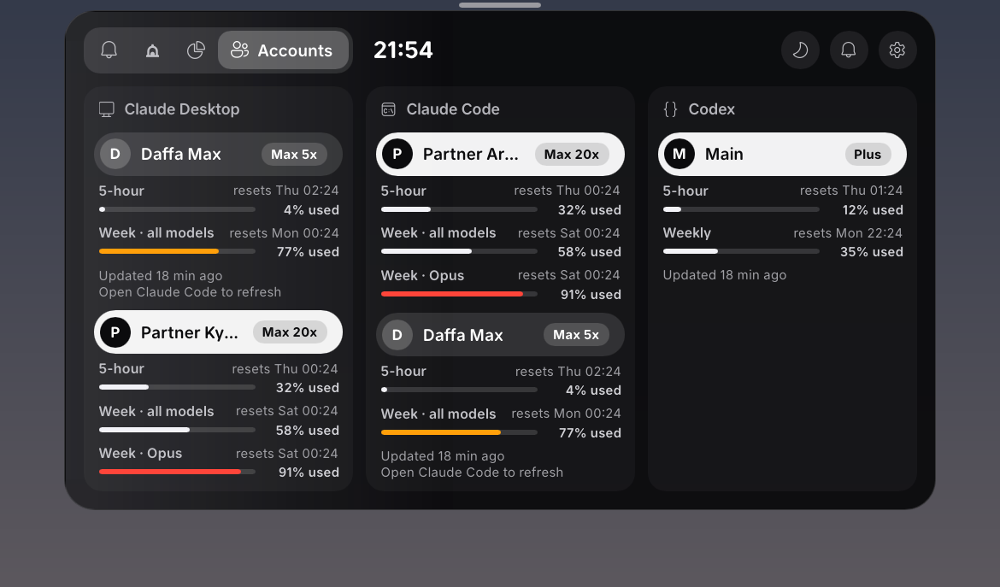
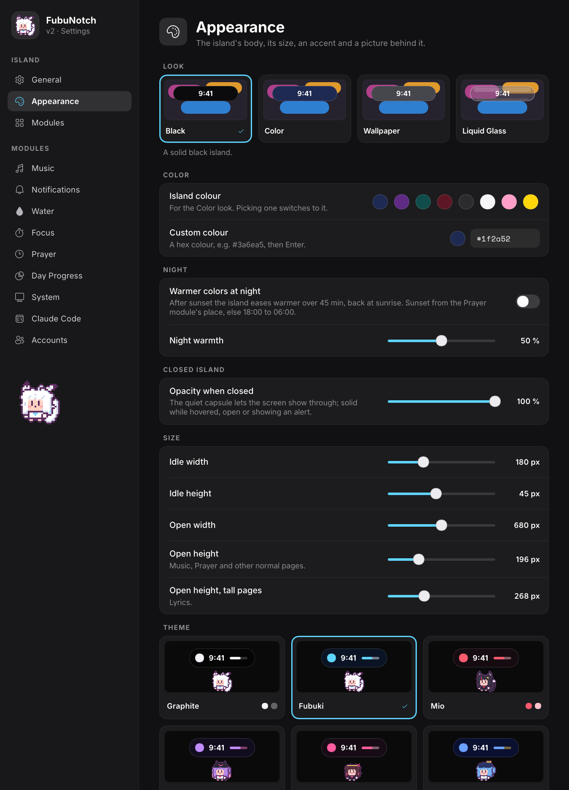

# Kanmuri

A small "dynamic island" for Windows: a capsule at the top of the screen that shows what is going on. The song playing (with synced lyrics), your notifications stacked per app, volume and device changes, prayer times, how much of the day is left, Pomodoro and water reminders, Claude Code's permission questions, and a switch between your Claude and Codex accounts.

Native Rust, no browser engine: about 40 MB of RAM and next to no CPU while it sits hidden.



> **Early test build.** It works day to day on the author's PCs, but it is young: expect rough edges, and please report what breaks.

## Download and install

1. Go to **[Releases](../../releases)** and download `kanmuri.zip` from the newest one.
2. Unzip it into a folder of its own. Keep the two `.exe` files (`kanmuri.exe`, `kanmuri-hook.exe`) together.
3. Run `kanmuri.exe`.
   - Windows SmartScreen may say "Windows protected your PC" because the app is not signed: click **More info → Run anyway**.
   - The first time, Windows asks whether the app may read your notifications: allow it if you want them on the island.
4. A small capsule appears at the top centre of the screen. Point at it to open the island. Right-click the tray icon (bottom right) for **Settings** and **Quit**.

To start it with Windows: Settings → General → Start with Windows.
To update: download the newest release and replace the two `.exe` files (quit Kanmuri first). Settings are kept.
To remove it: Quit from the tray, delete the folder, and delete `%APPDATA%\Kanmuri` (its settings).

Windows 10/11, 64-bit.

## What it does

The open island has one bar on top: the tabs, the time, and round buttons for a docked video, Do not disturb, notifications (with a red count) and Settings. The page below fills the width.

| | |
|---|---|
|  | **Music**: whatever is playing in Spotify, YouTube Music in a browser, or any player that shows in Windows' media controls. Play/pause, next, previous, a seek bar; shuffle and repeat when the player allows it (for YouTube Music in Chrome or Edge, add the small [extension](extension/ytm), since browsers don't pass shuffle and repeat to Windows). Synced lyrics from LRCLIB, or YouTube Music when LRCLIB has none, with furigana and romaji for Japanese. **Line** keeps the island a small capsule with just the line being sung. **Watch in island**: put a video in Chrome or Edge into picture-in-picture and Kanmuri docks it under the island. |
|  | **Notifications**: Windows notifications, mirrored on the island, with each app's own icon. Several from one app make one stack, as on an iPhone: the newest on top with the count on its icon; a click opens the stack, **‹ App** closes it. A click on a notification opens the app. A switch per app in Settings. While the module is on, Windows' own pop-up banners stay off for those apps (they still reach Windows' notification centre); turning the module off, or quitting Kanmuri, puts every app back as it was. **Do not disturb** keeps the island down for notifications, calls excepted. |
|  | **Accounts**: your Claude Desktop, Claude Code and Codex accounts, each with its plan and how much of its limits is used. A click switches: Claude Code and Codex through their config folder (new terminals use it), Claude Desktop by swapping its saved login (it restarts, so it asks for a second click first). Accounts set up with AccountDeck / NotchDeck (`%USERPROFILE%\.accountdeck`) are picked up as they are. |

Also:
- **Prayer**: today's prayer times (Kemenag method), worked out on your PC, with a reminder before each.
- **Day Progress**: how much of your waking day, week, month and year has gone, and what comes next.
- **Focus** and **Water**: a Pomodoro countdown and drink reminders on the capsule.
- **System** notices: volume, Caps Lock, keyboard layout, charger, Wi-Fi, headphones and Bluetooth headsets with their battery, and a dot while the microphone or camera is in use.
- **Claude Code**: Allow / Deny its permission requests from the island (Settings → Claude Code; it shows exactly what it will change in Claude Code's settings and backs the file up first).

### Looks

Settings → Appearance: a black body, a colour of your own, the wallpaper's colour, or Liquid Glass; warmer colours at night; how see-through the closed capsule is; the island's sizes; and a picture of your own behind it.



### Privacy

Nothing leaves your PC except what you turn on: lyrics look-ups send the song's title, artist, album and length to LRCLIB (and YouTube Music if that switch is on); the Accounts tab asks Anthropic for each Claude account's usage with that account's own login. No telemetry, no account of ours. Settings and data stay in `%APPDATA%\Kanmuri`.

## For developers

```
cargo run -p kanmuri               # the island
cargo test --workspace             # the checks
cargo build --profile fast         # the build that gets installed
.\scripts\try.ps1                  # three sample activities through the local webhook (-Clear ends them)
```

Needs Rust (stable) and the MSVC Build Tools ("Desktop development with C++"). UI in [Slint](https://slint.dev) with its software renderer. `crates/island-core` holds the activity contract and the arbiter (no UI, no I/O), `crates/island-webhook` a local webhook on `127.0.0.1:47821` that scripts and other apps can post activities to (bearer token in `%APPDATA%\Kanmuri\token`), `crates/island-lyrics` the lyrics. `CLAUDE.md` has the house rules.

Checks without a screen: `KANMURI_SNAPSHOT=out.png` draws the island into a PNG and exits (see `CLAUDE.md` for the switches that go with it).

## License and credits

The code is MIT, see [LICENSE](LICENSE). The typefaces are [Allo](app/assets/fonts/OFL-Allo.txt) by Josh Puckett and [Space Mono](https://github.com/googlefonts/spacemono) (Settings), both under the SIL Open Font License 1.1 ([app/assets/fonts/OFL.txt](app/assets/fonts/OFL.txt)). Icons are Windows' own Segoe Fluent Icons.

The repository also holds fan-art pixel mascots of hololive production talents (`app/assets/sprites/`), drawn for this project and not shown by the app at the moment. This is an unofficial, non-commercial fan project, not affiliated with or endorsed by COVER Corporation or hololive production; the MIT license does not grant any rights to the characters. If you are a rights holder and want something changed, please open an issue.
