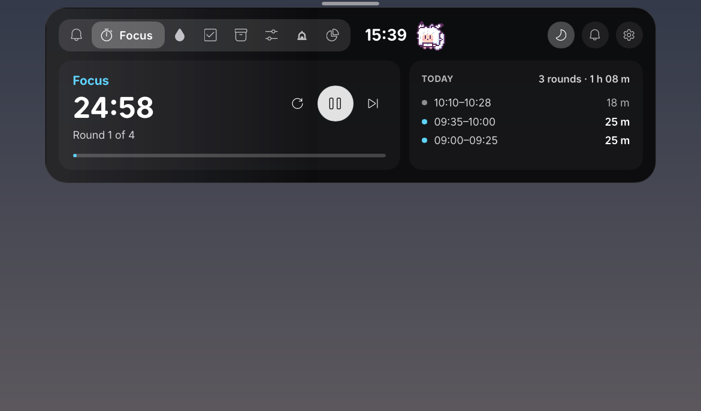
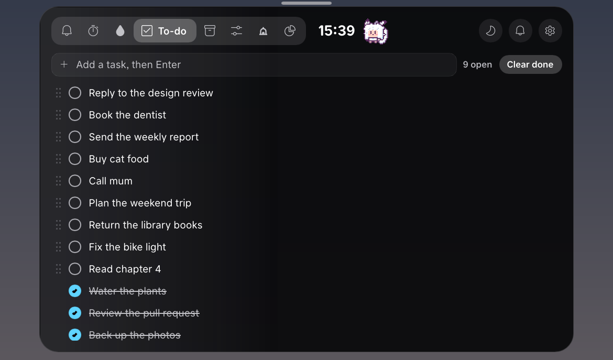

# FubuNotch v2

A small "dynamic island" for Windows: a capsule at the top of the screen that shows what is going on. The song playing (with synced lyrics), your notifications, volume and device changes, a Pomodoro, water reminders, a to-do list, a shelf for files, prayer times, how much of the day is left, quick controls, Claude Code's permission questions, and a switch between your Claude and Codex accounts. A pixel mascot lives in it.

Native Rust, no browser engine: about 40 MB of RAM and next to no CPU while it sits hidden.


> **Early test build.** It works day to day on the author's PC, but it is young: expect rough edges, and please report what breaks.

## Download and install

1. Go to **[Releases](../../releases)** and download `FubuNotch-v2-windows-x64.zip`.
2. Unzip it anywhere (for example `Documents\FubuNotch v2`). Keep the two `.exe` files (`fubunotch-v2.exe`, `fubunotch-v2-hook.exe`) together.
3. Run `fubunotch-v2.exe`.
   - Windows SmartScreen may say "Windows protected your PC" because the app is not signed: click **More info → Run anyway**.
   - The first time, Windows asks whether the app may read your notifications: allow it if you want them on the island.
4. A small capsule appears at the top centre of the screen. Point at it to open the island. Right-click the tray icon (bottom right) for **Settings** and **Quit**.

To start it with Windows: Settings → General → Start with Windows.
To update: quit FubuNotch from the tray and replace the two `.exe` files. Settings are kept. The app never updates itself.
To remove it: Quit from the tray, delete the folder, and delete `%APPDATA%\FubuNotch v2` (its settings).

Windows 10/11, 64-bit.

## What it does

The open island has one bar on top: the tabs, the time, the mascot, and round buttons for Do not disturb, notifications (with a red count) and Settings. The page below fills the width. Tabs follow the order in Settings → Modules.

| | |
|---|---|
|  | **Music**: whatever is playing in Spotify, YouTube Music in a browser, or any player that shows in Windows' media controls. Play/pause, next, previous, a seek bar; shuffle and repeat when the player allows it (for YouTube Music in Chrome or Edge, add the small [extension](extension/ytm), since browsers don't pass shuffle and repeat to Windows). Synced lyrics from LRCLIB, or YouTube Music when LRCLIB has none, and for Japanese, furigana over the kanji and romaji under the line (the あ and Ro switches on the lyrics card). **Line** keeps the island a small capsule with just the line being sung. |
|  | **Notifications**: Windows notifications, mirrored on the island, with each app's own icon. One app shows two at most, so a busy chat can't fill the page. A click opens the app. A switch per app in Settings. While the module is on, Windows' own pop-up banners stay off for those apps (they still reach Windows' notification centre); turning the module off, or quitting FubuNotch, puts every app back as it was. **Do not disturb** keeps the island down for notifications, calls excepted; it comes on by itself while a Focus round runs. |
|  | **Focus** and **Water**: Pomodoro rounds and breaks with a log of how long each round really was; a glass at a time toward a daily goal, reminders after a while without one, only inside your active hours. |
|  | **To-do** and **Shelf**: tick to strike through (done ones sink to the bottom), drag the dots to reorder, a log of what you cleared; drop files on the island to keep them handy (only their place is remembered). |

Also:
- **Control**: volume and brightness sliders; switches for Wi-Fi, Bluetooth, the microphone, keep awake, dark mode and lock; the weather (Open-Meteo, off until you turn it on); which output and which microphone are in use.
- **Idle island sides**: next to the time, pick the date, network, battery, the next prayer, CPU, RAM or disk (Settings → General).
- **Prayer**: today's prayer times (Kemenag method), worked out on your PC, with a reminder before each.
- **Day Progress**: how much of your waking day, week, month and year has gone, and what comes next.
- **System** notices: volume, Caps Lock, keyboard layout, charger, Wi-Fi, headphones and Bluetooth headsets with their battery, and a dot while the microphone or camera is in use.
- **Claude Code**: Allow / Deny its permission requests from the island, and answer its multiple-choice questions there. Settings → Claude Code connects it; it shows exactly what it will change in Claude Code's settings and backs the file up first.
- **Accounts** (once you keep accounts in `%USERPROFILE%\.accountdeck`): your Claude Desktop, Claude Code and Codex accounts with their plans and usage; a click switches. Settings → Accounts adds, renames, signs in and removes them, and **Send setup** copies parts of one Claude Code account's setup into another. Nothing there happens without a click.

### Looks

Five themes, each with its own colours and pixel mascot: **Fubuki**, **Mio**, **Towa**, **AZKi** and **Suisei** (and a neutral **Graphite**). The mascot breathes, blinks, wags, walks about, naps when left alone and hops when you click her; in Settings she walks the sidebar and climbs its edge. Settings → Appearance also has a black body, a colour of your own, the wallpaper's colour or Liquid Glass; warmer colours at night; how see-through the closed capsule is; the island's sizes; and a picture of your own behind it.


### Privacy

Nothing leaves your PC except what you turn on: lyrics look-ups send the song's title, artist, album and length to LRCLIB (and YouTube Music if that switch is on); the Weather module, once on, sends the Prayer place's coordinates to Open-Meteo; the Accounts tab asks Anthropic for each Claude account's usage with that account's own login. No telemetry, no updater, no account of ours. Settings and data stay in `%APPDATA%\FubuNotch v2`.

## For developers

```
cargo run -p fubunotch-v2          # the island
cargo test --workspace             # the checks
cargo build --profile fast         # a quick optimised build (the app crate unoptimised)
.\scripts\try.ps1                  # three sample activities through the local webhook (-Clear ends them)
.\scripts\watch-island.ps1         # pictures of the running island for a while, plus its log
python scripts\sprites.py          # redraw the mascots from pixel-art\holo-tiny\build.py
```

Needs Rust (stable) and the MSVC Build Tools ("Desktop development with C++"). UI in [Slint](https://slint.dev) with its software renderer. `crates/island-core` holds the activity contract and the arbiter (no UI, no I/O), `crates/island-webhook` a local webhook on `127.0.0.1:47821` that scripts and other apps can post activities to (bearer token in `%APPDATA%\FubuNotch v2\token`), `crates/island-lyrics` the lyrics. `CLAUDE.md` has the house rules.

Checks without a screen: `FUBUNOTCH_V2_SNAPSHOT=out.png` draws the island into a PNG and exits (see `CLAUDE.md` for the switches that go with it).

## License

The code is MIT, see [LICENSE](LICENSE). The typefaces are [Allo](app/assets/fonts/OFL-Allo.txt) by Josh Puckett and [Space Mono](https://github.com/googlefonts/spacemono), both under the SIL Open Font License 1.1 ([app/assets/fonts/OFL.txt](app/assets/fonts/OFL.txt)). Icons are Windows' own Segoe Fluent Icons.

This is an unofficial, non-commercial fan project. It is not affiliated with or endorsed by COVER Corporation or hololive production. Shirakami Fubuki, Ookami Mio, Tokoyami Towa, AZKi and Hoshimachi Suisei are hololive production talents; the pixel mascots are fan art drawn for this project, and the MIT license does not grant any rights to the characters. If you are a rights holder and want something changed, please open an issue.
